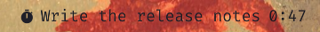

# Super Productivity for the Omarchy bar

A bar widget for the [Omarchy](https://omarchy.org/) shell that shows the task you're tracking in [Super Productivity](https://super-productivity.com/) and how long you've spent on it today. You can start and stop tasks from the bar, so the app can stay hidden in the tray.



## What it does

| Action | Result |
| --- | --- |
| Left click while a task runs | Stops tracking |
| Left click while nothing runs | Opens today's tasks; click one to start it |
| Right click | Opens today's tasks |
| Middle click | Shows or hides the Super Productivity window |
| Click while the app isn't running | Starts the app |

The widget only talks to the app's Local REST API on `127.0.0.1`. Nothing leaves your machine.

Today's time follows the calendar date. If you moved the start of your day past midnight in Super Productivity (Settings > General > Misc Settings), the bar shows 0:00 from midnight until then.

## Install

```bash
omarchy plugin add https://github.com/SaintChris/omarchy-super-productivity.git --enable --yes
```

The widget lands on the right of the bar. Move it with `omarchy bar move saintchris.super-productivity --section center`.

## Set up Super Productivity

1. In Super Productivity, open **Settings > General > Misc Settings** and turn on **Enable local REST API**. This needs version 18.17 or later.
2. In the same place, turn on **Minimize to tray**. Closing the window then hides the app in the tray instead of quitting it, and the widget keeps working.
3. To start the app at login, add it to `~/.config/hypr/autostart.lua`:

   ```lua
   o.launch_on_start("superproductivity")
   ```

## Settings

The defaults suit a standard install. Change them with `omarchy bar set`:

| Key | Default | What it is |
| --- | --- | --- |
| `port` | `3876` | REST API port |
| `tokenFile` | `~/.config/superProductivity/local-rest-api-token` | File holding the API token |
| `launchCommand` | `superproductivity` | Command that starts the app (AppImage path, Flatpak command and so on) |
| `maxWidth` | `220` | Longest task title in the bar, in pixels |

For example, for an AppImage with its own data folder:

```bash
omarchy bar set saintchris.super-productivity launchCommand "$HOME/Applications/Super-Productivity.AppImage --user-data-dir=$HOME/.config/sp-work"
omarchy bar set saintchris.super-productivity tokenFile "~/.config/sp-work/local-rest-api-token"
```

## License

MIT
